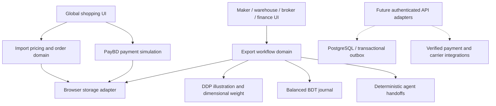

# BongoBridge architecture and implementation plan

## Decision and scope

The main BongoBridge experience remains global shopping and shopping-proxy imports into Bangladesh. A second bounded context, **Bangladesh Maker Exports**, implements the supplied blueprint as a classroom operations workspace. Both share the evergreen, cream, and lime design, accessible controls, and original BongoBridge identity.

The standing constraint is **educational use, generated data, and no paid infrastructure or billing setup**. The implementation therefore demonstrates real software rules inside a browser while making a clear distinction between a simulation and a live trade system. No identity documents, personal addresses, real OTPs, card details, bank accounts, carrier credentials, or regulatory credentials are collected.

## Architecture adopted now

Use a modular application with explicit domain boundaries before introducing independently deployed microservices. This makes state transitions testable without requiring multiple servers, paid queues, databases, or observability products. A later backend can reuse the domain concepts behind authenticated API adapters.

### Source organization

| Area | Responsibility |
| --- | --- |
| `src/index.html`, `styles.css`, `enhancements.css` | Site shell, original theme, photography, responsive layouts, reduced-motion support. |
| `src/app.js` | Storefront routing, catalog/search, bag, checkout review, tracking, customer demo dashboard. |
| `src/engine.js` | Existing shopping state and order persistence, with the pricing module as its calculator. |
| `src/modules/pricing.js` | Pure import and export quotes, parcel weights, fixed FX fixtures, minor-unit export accounting. |
| `src/modules/payments.js` | Adapted PayBD method/verification/processing/result UI and guarded payment-state transitions. |
| `src/modules/operations-domain.js` | Generated makers/listings, command guards, export state machine, consolidation, journal posting, event log. |
| `src/modules/workspace.js` | Openly selectable classroom role workspaces and draft document presentation. |
| `src/modules/motion.js` | Photo-to-bag animation, image confirmation, button/badge feedback, reveal and page transitions. |
| `src/assets/products/` | Locally bundled real reference photographs, with license/attribution credits. |
| `database/` | Generated shopping data and optional private-schema SQL teaching models. |
| `architecture/` | Requirements mapping, API contracts, integration boundaries, phased plan. |
| `tests/` | Meaningful calculations, state-machine, ledger, validation, and persistence tests. |
| `docs/` | Generated GitHub Pages publication output; synchronize from `src/`. |

The previous `dist/` source layout is replaced by `src/`; `docs/` remains the free hosting output. No framework dependency or installation is needed.

## Blueprint requirements mapped to implementation

| Blueprint capability | Implemented classroom behavior | Production work deliberately deferred |
| --- | --- | --- |
| Multi-role onboarding | Four generated maker profiles; Maker, Warehouse, Broker, Finance, Automation tabs; command responsibility checks. | Real authentication, server-issued roles, tenancy enforcement, KYC/AML, encrypted document storage and licensing checks. |
| Physical catalog | Preset materials, Bangladesh-origin export listings, actual weight, package dimensions, HS suggestion and confidence. | Verified origin/material evidence, authoritative tariff classification, actual inventory and seller uploads. |
| Multilingual enrichment | Bengali/English listing fixture; explainable enrichment pipeline. | Speech transcription, image interpretation, LLM translation, vector search and evaluated AI models. |
| Human review | Below-95% confidence and certificate scenarios require explicit human review; all exports require broker approval. | Licensed broker workflow, audited identity, verified tariff evidence and regulatory sign-off. |
| Restricted goods | A blocked test listing demonstrates a stop before submission/document generation. | Actual restricted-goods and sanctions datasets, change monitoring and legally reviewed policy. |
| Import pricing | BDT item prices, 70% mock item advance, later balance, combined freight/customs fixture, local delivery. | Live merchant prices, binding quotes, real freight/customs reconciliation and consumer terms. |
| Export DDP engine | Supplier amount, margin, first mile, freight, insurance, duty/VAT fixtures, broker fee, last mile, fixed BDT/USD/EUR/GBP conversion. | Current jurisdiction-specific valuation/tax rules, policy ownership, actual FX feeds and binding quote guarantees. |
| Dimensional freight | `max(actual kg, L×W×H/5000)`, evaluated across quantity; warehouse measurement refreshes quote. | Carrier-specific divisors, packing/consolidation models, scales and device integrations. |
| Domestic pickup/hub | Review → pickup arranged → measured Dhaka hub intake → consolidation → departure → delivery. | Domestic courier bookings, actual scanner telemetry, transport contracts and carrier events. |
| Consolidation | Compatible destination consignments receive generated master-carton references. | Capacity/packing optimization, real master/house AWBs, destination warehouse stock. |
| Documents | Watermarked draft commercial invoice and packing list preview/download, mock export-document reference. | Actual Bill of Export/EXP/e-BRC, ASYCUDA/OEMS filing, official carrier labels, legitimate barcodes. |
| Payment gateway | Minimal PayBD UI adaptation; five methods, fake code, processing, paid/declined/cancelled/expired screens. Successful simulation alone creates shopping orders. | Provider SDKs, acquiring, secure webhooks, real card tokenization, financial settlement, payment licenses. |
| Supplier payout | Departure + review + hub verification + mock document gate; idempotent BDT double-entry journal and distinct payout result screen. | Actual bKash/Nagad/bank transfer, FX settlement, payouts ledger isolation, bank reconciliation and audit controls. |
| Events | Append-through-command scenario event log, UTC plus Asia/Dhaka rendering. | Transactional outbox, durable queue, webhook signature/replay controls and immutable audit storage. |
| Performance/security | Lightweight static assets, local domain tests, browser checks, reduced motion. | 1,500 RPS/450 ms load proof, 99.95% SLA, PCI certification, encryption/key-management guarantees or production zero trust. |

## End-to-end flows and acceptance criteria

### Shopper import flow

1. Search/filter a photographic catalog. Every item has a BDT price, sample weight, and indicative combined freight/customs rate.
2. Add an item. The clicked button confirms, the badge animates, an image moves toward the bag when motion is allowed, and a visible image/name/quantity confirmation offers a direct next step.
3. Review separate item, combined freight/customs, and local-delivery amounts. The 70% advance is based on the item value alone; the remainder is explicit.
4. Choose one of the five adapted PayBD methods. Enter **only the displayed fake code `000000`**. Processing and terminal result each have their own screen.
5. On simulated success, create each parcel once and attach the payment reference. Failed, cancelled, and expired attempts preserve the bag and create no shopping orders.
6. Follow the sample shipping timeline or advance a dummy order in the customer demo admin view. Persist only dummy state.

### Maker export flow

1. Select a generated listing, quantity, destination, display currency, and full/semi-managed model. A complete DDP teaching quote appears beside it.
2. Submit to broker review. Restricted test fixtures cannot be submitted.
3. The broker acknowledges human review where required, then approves the scenario. Draft documents are clearly invalid for real trade; recording a mock reference does not file anything.
4. The warehouse records measured weight and dimensions. The quote is recomputed, then the consignment can join a destination master carton.
5. Departure is blocked until review, verified intake, carton assignment, and mock document recording are complete.
6. Finance records a simulated supplier payout. Each journal balances in integer BDT minor units; a repeated payout command cannot post it twice. No wallet/bank API runs.

### Automation demonstration

Run generated enrichment → HS suggestion → compliance → documentation steps with animated handoffs. The interface explicitly says these are deterministic fixtures, not live AI. Below-threshold classification routes to review. A restricted fixture demonstrates a blocked document path.

## Phased development roadmap

### Phase A — current zero-cost classroom implementation

Deliver modular source, photographic catalog, clear add-to-bag feedback, staged pricing, PayBD simulation, maker/operations roles, domain command gates, dimensional weight, draft documents, journal/events, automated tests, and refreshed GitHub Pages deployment. Acceptance: all domain tests pass and shopper/payment/export workflows complete in desktop and mobile browser checks.

### Phase B — local development foundation, only when requested

Implement a single authenticated backend before distributing services. Use the reference PostgreSQL schema and API contracts. Put tenant authorization, money calculations, idempotency, quote snapshots, stock reservations, and payout gates on the server. Use transactions and an outbox for order/payment/warehouse events. Add integration tests for cross-tenant reads, duplicate callbacks, stale quote acceptance, inventory races, and ledger reconciliation. No paid cloud resource is part of the current delivery.

### Phase C — independently approved real integrations

After the user changes the demo-only scope, choose providers, confirm free/sandbox availability and any costs, obtain legitimate credentials, verify operator readiness and laws, then implement one sandbox adapter at a time. Providers must remain behind replaceable adapters; secrets stay server-side. Real-money payment callbacks, logistics bookings, document filing, or supplier transfers require new explicit authorization.

### Phase D — measured scale and evaluated automation

Load-test the actual workload before choosing independent services, caches, regional replication, queues, or autoscaling. Introduce model-based enrichment and classification only after an approved budget, privacy review, evaluation dataset, confidence calibration, traceability and human fallback are in place. Treat the blueprint’s latency and availability numbers as targets until measured.

## Current regulatory boundaries

The blueprint is a design input, not a reliable current tariff/policy database. For example, its blanket US `$800` duty-free assumption is unsuitable: official US notices describe the suspension of de minimis treatment. The demo never automatically grants an exemption or represents its HS/tax fixtures as legal classification. Bangladesh circular dates, thresholds, statutory IDs and destination taxes need current professional verification before live behavior.

Primary reference checked: [US Federal Register, Low-Value Shipments, 8 October 2026](https://www.govinfo.gov/content/pkg/FR-2026-10-08/html/2026-20650.htm). Pricing UX inspiration: [SkyBuy shipping information](https://skybuybd.com/custom-and-shipping-charge) and [terms](https://skybuybd.com/terms-conditions). These do not establish BongoBridge prices or permissions.

## Cost guardrails

Keep GitHub Pages and a public, noncommercial educational repository. No subscription, custom domain, metered Worker/function/database, paid AI request, secret, payment provider or carrier connection is introduced. Runtime assets are bundled locally. A service quota or access failure is a stop condition for that integration, not permission to upgrade or spend money.
